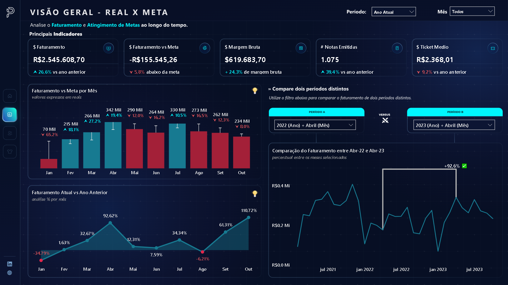
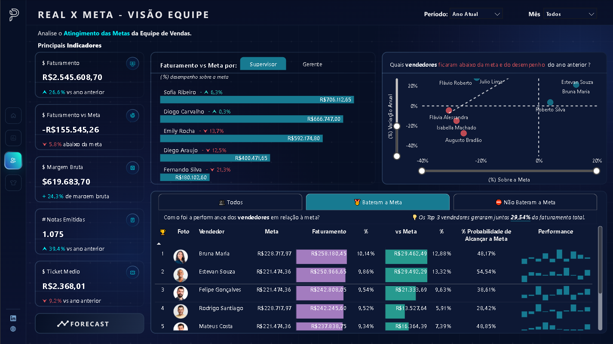
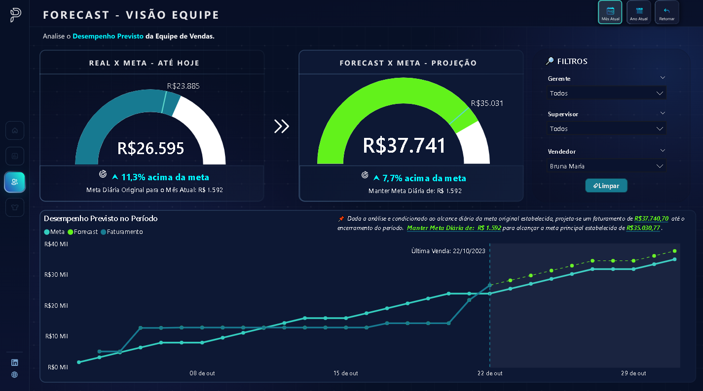
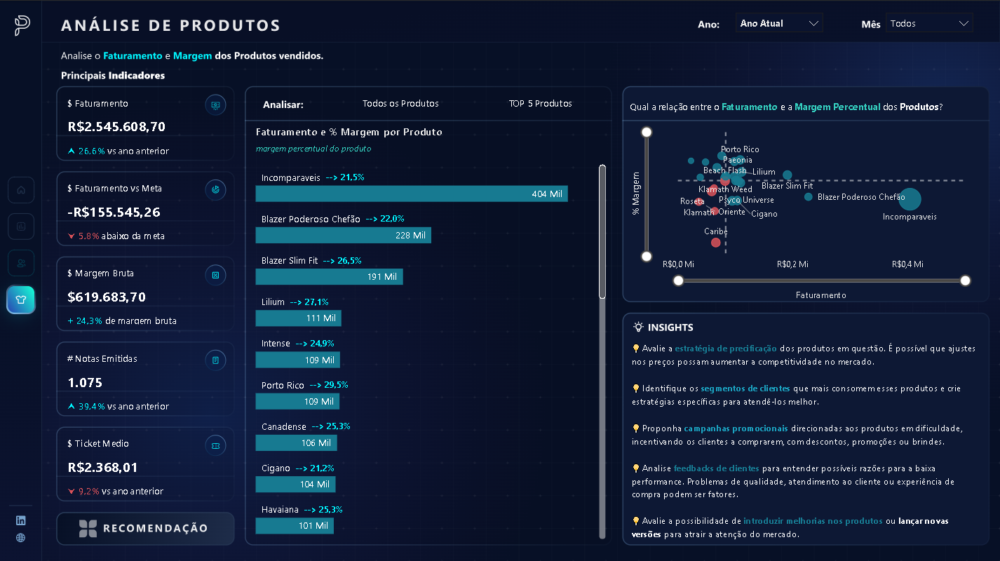
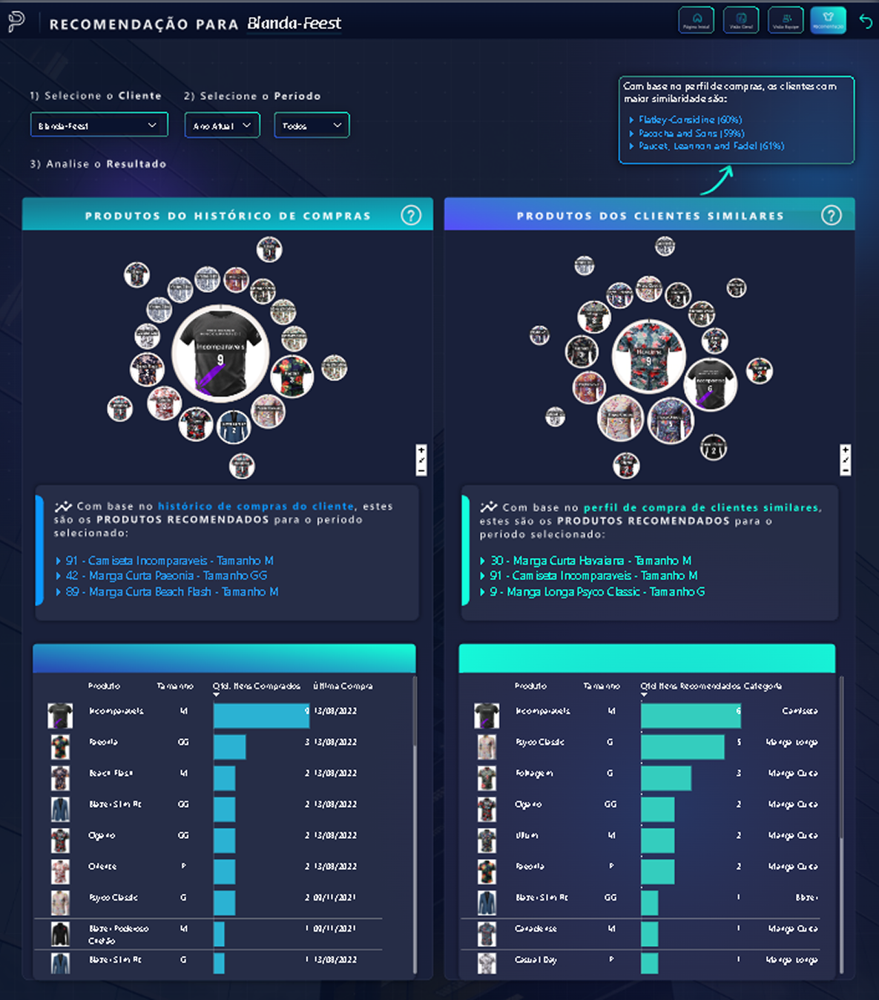

# 📊 Dashboard de Vendas: Real x Meta, Forecast e Recomendação

Solução de Business Intelligence ponta a ponta que integra **SQL Server**, **Python** e **Power BI** para acompanhar o atingimento de metas, a performance da equipe comercial, a projeção de faturamento e a análise de produtos, com **recomendações inteligentes de produtos por cliente**.

---

## 🎯 Objetivo

Apoiar decisões comerciais de forma rápida e baseada em dados, respondendo perguntas como:

- Estamos acima ou abaixo da meta? Em quais meses e para quais vendedores?
- Quais vendedores ficaram abaixo da meta **e** abaixo do desempenho do ano anterior?
- Qual a projeção de faturamento até o fim do período e quanto é preciso vender por dia para bater a meta?
- Quais produtos geram mais faturamento e margem?
- Quais produtos recomendar para cada cliente?

---

## 🧱 Arquitetura

```
SQL Server ──► Views dimensionais ──► Python (análises + recomendação) ──► Power BI
 (origem)      (modelo estrela)        (similaridade, insights)           (dashboard)
```

| Camada               | Tecnologia     | O que faz                                                    |
| -------------------- | -------------- | ------------------------------------------------------------ |
| Extração e modelagem | SQL Server     | Estrutura os dados em views dimensionais (fatos e dimensões) |
| Enriquecimento       | Python         | Gera análises e o motor de recomendação de produtos          |
| Visualização         | Power BI (DAX) | Indicadores, metas, forecast, ranking e recomendações        |

---

## 🖥️ Páginas do Dashboard

### 1. Visão Geral: Real x Meta

Panorama do faturamento e do atingimento de metas ao longo do tempo.

- Cards de KPI: **Faturamento**, **Faturamento vs Meta**, **Margem Bruta**, **Notas Emitidas** e **Ticket Médio**, todos com variação vs ano anterior
- Faturamento vs Meta por mês, com destaque de meses acima e abaixo da meta
- Faturamento atual vs ano anterior (análise % por mês)
- **Comparador de dois períodos distintos** (Período A _versus_ Período B)
  

### 2. Real x Meta: Visão Equipe

Desempenho da equipe de vendas frente às metas.

- Faturamento vs Meta por **Supervisor** ou **Gerente**
- Gráfico de dispersão: vendedores abaixo da meta **e** abaixo do desempenho do ano anterior
- Ranking de vendedores com meta, faturamento, variação vs meta, **probabilidade de alcançar a meta** e mini-gráfico de performance
- Filtro: _Todos_, _Bateram a Meta_ e _Não Bateram a Meta_
- Insight automático de concentração (ex.: participação dos Top 3 vendedores no faturamento)
  

### 3. Forecast: Visão Equipe

Projeção de faturamento com base no ritmo de vendas.

- **Real x Meta até hoje** e **Forecast x Meta (projeção)**, em medidores
- Meta diária original e meta diária necessária para fechar o período
- Linha do tempo com Meta, Forecast e Faturamento, marcando a data da última venda
- Filtros por Gerente, Supervisor e Vendedor, com alternância entre **Mês Atual** e **Ano Atual**
- Texto dinâmico com a projeção e a meta diária a ser mantida
  

### 4. Análise de Produtos

Relação entre faturamento e margem por produto.

- Faturamento e % de margem por produto (todos ou Top 5)
- Dispersão **Faturamento x Margem %** para identificar produtos de alto volume e baixa margem
- Painel de **Insights** com sugestões de ação (precificação, segmentação, campanhas, feedback e melhorias)
  

### 5. Recomendação por Cliente

Motor de recomendação desenvolvido em Python e consumido no Power BI.

- Seleção de **cliente** e **período**
- **Produtos do histórico de compras:** itens recomendados com base no que o cliente já comprou
- **Produtos dos clientes similares:** itens recomendados com base no perfil de compra de clientes parecidos (com % de similaridade)
- Tabelas com produto, tamanho, quantidade, última compra e categoria
  

---

## 🧠 Lógica de Recomendação

1. **Histórico do cliente:** ranqueia os produtos mais comprados pelo próprio cliente no período.
2. **Clientes similares:** calcula a similaridade entre perfis de compra e recomenda os produtos mais frequentes entre os clientes mais próximos.
3. O resultado é exposto no Power BI com os produtos recomendados e os clientes de maior similaridade.

---

## 🛠️ Stack

- **SQL Server**: views dimensionais
- **Python**: análise de dados e recomendação
- **Power BI + DAX**: modelagem semântica, medidas e visualização
- **Design**: tema escuro com navegação lateral e cards de KPI

---

## 📁 Estrutura sugerida do repositório

```
├── sql/            # Views dimensionais
├── python/         # Notebooks e scripts de análise e recomendação
├── powerbi/        # Arquivo .pbix
├── images/         # Prints das páginas do dashboard
└── README.md
```

---

## 👤 Autor

**Rafael (Rafa)**: Analista de Dados / BI
📍 São Paulo, Brasil
🔗 [LinkedIn](#) · 🌐 [Portfólio](#)
